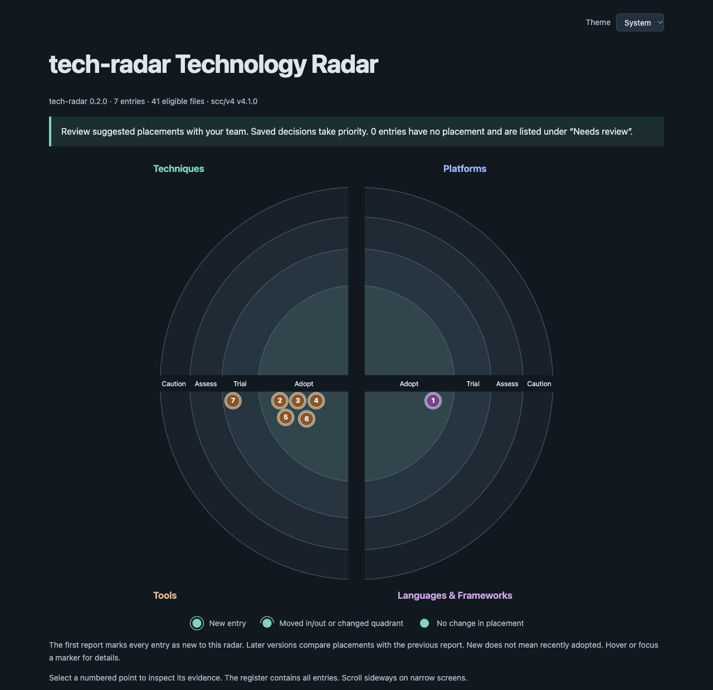

# tech-radar scans itself

This is a radar of the tool that builds these reports. The scan ran on 2026-11-01, with the same CLI you use for your own repositories. It found seven technologies. Source review gives the declared libraries readable names and proposed placements. No findings need a display exclusion.

[Open the interactive radar](output/tech-radar.html). It is a self-contained HTML file, so you can save it and open it offline.



The outer circles mark new entries in this first report. Every placement is proposed. None records an approval, and this example supplies no enforcement standard.

## What made the radar

Go is the application language. The main libraries each have a separate job, so the review keeps them as separate entries. Sharing a Go module is not a reason to group unrelated dependencies.

| Entry | Role | Evidence checked during review |
| --- | --- | --- |
| Go | CLI and scanner implementation | `go.mod`, `cmd/tech-radar/main.go` |
| scc | File classification and source statistics | `go.mod:7`, `internal/radar/languages.go:10` |
| go-gh | GitHub API client for optional remote collection | `go.mod:8`, `internal/discovery/transport.go:11` |
| flock | Coordination between processes writing an export | `go.mod:9`, `cmd/tech-radar/output.go:42` |
| Masterminds SemVer | Version constraints in policy checks | `go.mod:6`, `internal/radar/check_policy.go:128` |
| Hugo Book | Theme for this handbook | `docs/go.mod:5`, `docs/hugo.toml:10` |
| Plugin and skill artifacts | Repository review workflow for Codex and Claude Code | `plugin/tech-radar/plugin.json`, `plugin/tech-radar/skills/review/SKILL.md` |

Go receives an automatic Adopt proposal from its source evidence. The display file proposes Adopt for the five libraries because declarations and imports or configuration show their current use. The plugin keeps its automatic Trial proposal. These are review suggestions for this repository, not recommendations that every project adopt the same stack.

## What the review changed

The first version of this example exposed a scanner bug: regular-expression definitions and catalog labels were being treated as technology use. The scanner now filters Go regexp arguments and checks framework syntax in its applicable languages. Ignore-file syntax stays in language statistics without becoming a technology choice. This run needs no exclusions for those cases.

The observations remain in the [raw scan](inventory.json) and the report's embedded evidence. The display file gives the five declared libraries readable names, a Tools quadrant, and proposed Adopt placements. It adds no detection or grouping rules.

This is one reason to inspect the evidence before treating a generated radar as policy. Static reference matching can find a technology in code that talks about it. Zero scan warnings does not rule out false positives or missing technologies. The theme declaration appears as Hugo Book; this run does not create a separate finding for the Hugo executable or prove which agent hosts are installed.

## Repeat the run

From the tech-radar checkout, [build the CLI](/docs/getting-started/installation), then save the [display input](display.json) somewhere outside the source tree. Set its path below:

```sh
radar_display=/path/to/display.json
radar_run=$(mktemp -d)

./tech-radar scan --repo . --out "$radar_run/inventory.json"
./tech-radar generate --repo . --name tech-radar \
  --policy "$radar_display" --format html --self-contained \
  --out "$radar_run/RADAR.html"
```

The captured run printed:

```text
Generated .../RADAR.html: 7 entries, 0 policy exclusions, 0 scan warnings
```

That count describes the saved source snapshot. A later checkout can produce different findings. The embedded evidence records the source fingerprint and scanner versions for this example.

The [agent review workflow](/docs/guides/agents) guided the source inspection. The saved display file records the resulting proposals and exclusions, so generation does not need a model to repeat those decisions. Review it against your checkout before reusing it.
